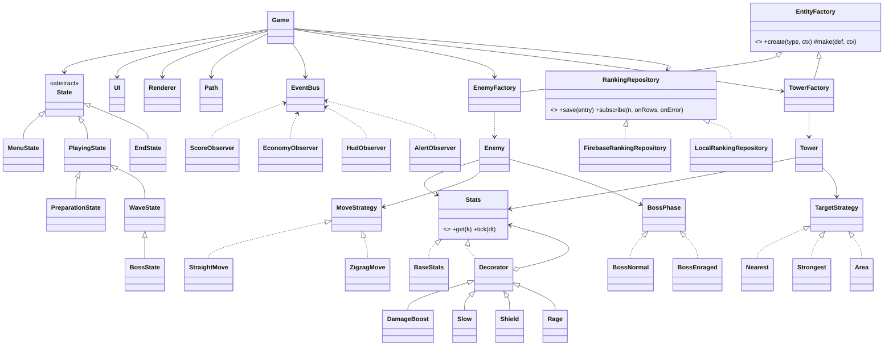

# Tower Defense · Patrones de Diseño

Juego de defensa de torres por oleadas en HTML + CSS + JavaScript puro, con ranking en vivo en Firebase Firestore.
Material de coevaluación (guion de pruebas, checklist y plantilla): ver [COEVALUACION.md](COEVALUACION.md).

## Ejecutar
Abre la carpeta con **Live Server** (los módulos ES no funcionan con doble clic) o publícala en GitHub Pages. Requiere Firestore creado y las reglas publicadas (colección `ranking`: `nombre`, `puntaje`, `nivel`, `fecha`).

## Cómo se juega
Escribes tu nombre y pulsas **Jugar**. Elige una torre, haz clic en el mapa para construirla y pulsa **Iniciar oleada**. Las habilidades (Furia, Congelar) cuestan oro. Hay 10 niveles; cada uno sube la vida y velocidad de los enemigos y añade tipos nuevos (corredores, zigzag, blindados con armadura, sanadores, titanes, escudos y dos jefes). Al terminar (victoria o derrota) el puntaje se guarda solo y el Top 10 se actualiza en vivo para todos los jugadores.

## Estructura
```
index.html  style.css  levels.json   <- toda la configuración del juego
js/
  main.js            punto de entrada, inyecta el repositorio
  game.js            contexto del juego (coordina)
  states.js          State: fases del juego y del jefe
  strategies.js      Strategy: movimiento y objetivo de torres
  factories.js       Factory Method: enemigos y torres
  decorators.js      Decorator: potenciadores temporales
  observers.js       Observer: bus de eventos y observadores
  entities.js        Path, Enemy, Tower
  render.js ui.js    dibujo del canvas y DOM
  ranking.js firebaseRanking.js firebase-config.js   ranking (interfaz, Firestore, config)
```

## Patrones
| Patrón | Categoría | Dónde | Problema que resuelve |
|---|---|---|---|
| Factory Method | Creacional | `factories.js` | Crear enemigos/torres según tipo y nivel sin `if` dispersos |
| Decorator | Estructural | `decorators.js` | Potenciadores temporales apilables (Furia, Congelar, Escudo, furia del jefe) |
| Strategy | Comportamiento | `strategies.js` | Movimiento de enemigos y objetivo de torres intercambiables |
| State | Comportamiento | `states.js` | Fases del juego (Menú, Preparación, Oleada, Jefe, Fin) y fases del jefe |
| Observer | Comportamiento | `observers.js` | Puntaje, oro, HUD y alertas reaccionan a eventos sin acoplarse |

## Ausencia de código rígido
Toda cifra de juego vive en `levels.json`: vida, velocidad, armadura, recompensas, costos, alcance, daño, cadencia, multiplicadores de cada habilidad y escudo, curación del sanador (cantidad, radio, frecuencia), umbral y fuerza de la furia del jefe, amplitud del zigzag, fórmulas de puntaje, distancias de construcción y las oleadas de cada nivel. Agregar un enemigo, torre, habilidad o nivel no requiere tocar el código.

## SOLID (con ejemplos del código)
- **S (responsabilidad única):** `Renderer` solo dibuja, `UI` solo toca el DOM, `EventBus` solo reparte eventos, `Path` solo hace geometría, `TowerFactory` solo crea torres.
- **O (abierto/cerrado):** una estrategia de disparo nueva (como `Area`) es una clase más y una línea en `TARGETING`, sin modificar `Tower`. Un enemigo o nivel nuevo es solo JSON.
- **L (sustitución de Liskov):** `FirebaseRankingRepository` y `LocalRankingRepository` sustituyen a `RankingRepository`; cualquier decorador sustituye a `BaseStats` porque `Tower.update` solo usa `stats.get()` y `stats.tick()`.
- **I (segregación de interfaces):** contratos mínimos: estrategias `advance(e, dt)` y `select(t, es)`, estadísticas `get/tick`, repositorio `save/subscribe`, estados `enter/update/click/exit`. Nadie depende de métodos que no usa.
- **D (inversión de dependencias):** `Game` recibe el repositorio por constructor desde `main.js` y depende de la abstracción, no de Firebase; `Tower` depende de `targeting.select`, no de `Nearest`.
- **Limitación reconocida:** `Game` concentra bastante coordinación y conoce las fábricas concretas; una mejora futura sería extraer el control de oleadas a su propia clase.

## UML

